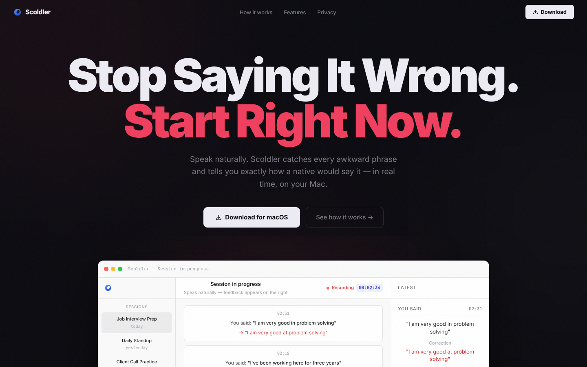

# Scoldler

A macOS app that listens while you speak English and tells you how a native speaker would say it.
Transcription (Whisper) and feedback (Ollama) both run on your Mac. No cloud, no account.



## Install

Download the `.dmg` from [Releases](https://github.com/scrawl-labs/scolder/releases/latest).

- The app isn't code-signed yet: open it once, then System Settings → Privacy & Security → **Open Anyway**.
- On first launch it downloads the Whisper model, the Ollama runtime and `llama3.1:8b`, so the first start takes a while.

Run from source (needs Node and Rust):

```sh
npm install
npm run tauri dev
```

## Structure

```
src/         the app UI (React + TypeScript)
src-tauri/   the native side (Rust): audio, Whisper transcription, Ollama feedback, sessions
site/        the website
```
